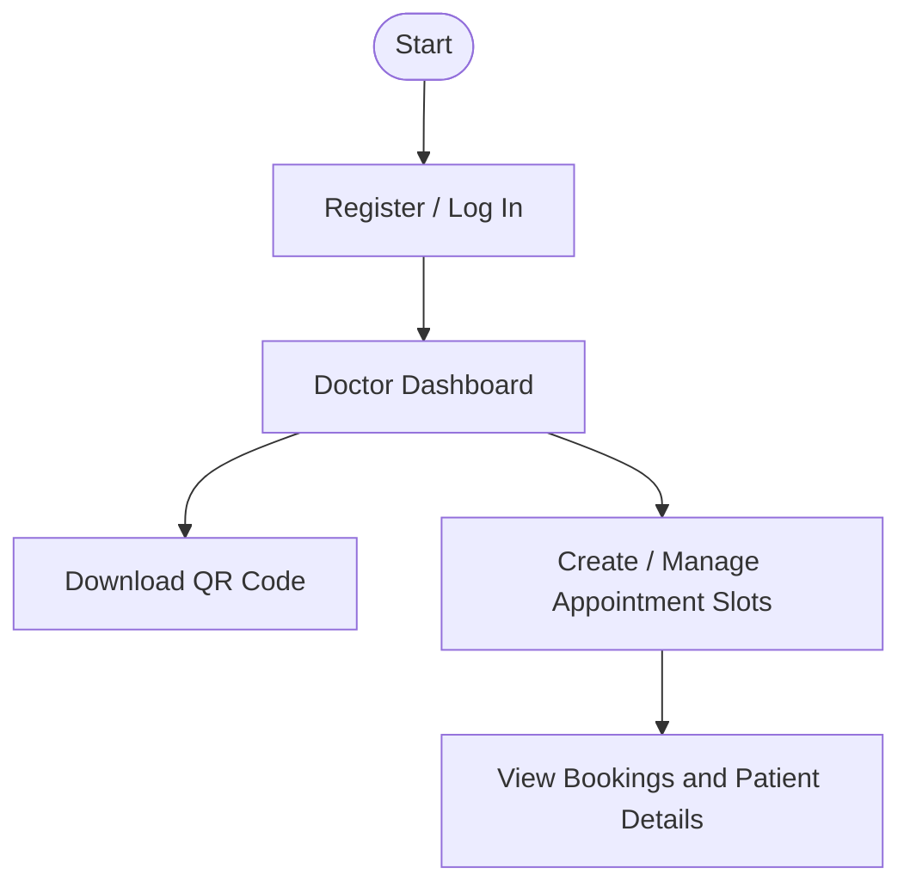
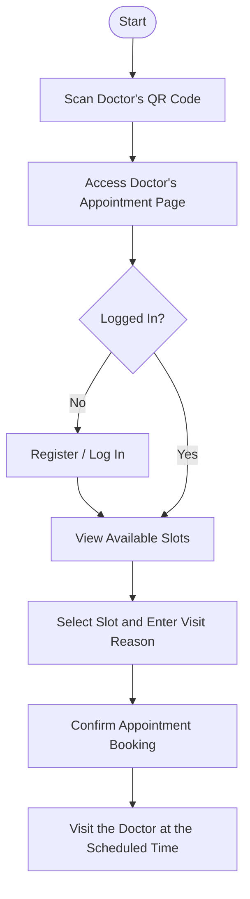

# MediLink: Plan Your Visit. Book with Ease.

## Overview

MediLink is a web-based doctor appointment booking application built using Flask and SQLite. It allows doctors to create and manage appointment slots while patients can view available slots and book appointments with their preferred doctors.

Each doctor has a unique QR code that patients scan to access the doctor's page, making it easier to find and book appointments with a specific doctor. The application provides separate interfaces for doctors and patients, simplifying the appointment booking process.

## Features

- **User Authentication:** Separate registration and login for doctors and patients.
- **Doctor QR Codes:** Each doctor gets a unique, downloadable QR code linking directly to their appointment page.
- **Slot Management:** Doctors can create and manage appointment slots through their dashboard.
- **Appointment Booking:** Patients can view available slots, select a suitable time, and optionally provide their reason for the visit.
- **Booking Management:** Doctors can view booked appointments along with patient details and visit reasons.
- **Appointment Status:** Indicates when a scheduled appointment is active through a time-based join button and status message.
- **Persistent Data Storage:** SQLite stores user accounts, appointment slots, and booking records.

## Tech Stack

+ **Backend:** Python, Flask
+ **Frontend:** HTML, CSS, Jinja2
+ **Database:** SQLite3
+ **Libraries:** Flask-WTF, WTForms, Werkzeug, qrcode
+ **Standard Library:** datetime

## Project Structure

```text
MediLink/
├── app.py              # Flask application and routes
├── templates/          # Jinja2 HTML templates
├── static/             # CSS and other static assets
├── user.db             # SQLite database (if stored locally)
├── requirements.txt    # Python dependencies
└── README.md           # Project documentation
```

## Installation and Setup

1. **Clone the repository**
   ```bash
   git clone <repository-url>
   cd project
   ```

2. **Create a virtual environment**
   ```bash
   python -m venv venv
   ```

3. **Activate the virtual environment** (Windows)
   ```bash
   venv\Scripts\activate
   ```

4. **Install dependencies**
   ```bash
   pip install -r requirements.txt
   ```

5. **Configure environment variables**

   Create a `.env` file in the project root and add your Flask secret key:

   ```dotenv
   SECRET_KEY=your_generated_secret_key
   ```

6. **Run the application**
   ```bash
   flask run
   ```

7. Open the local URL displayed in the terminal in your browser.

## How to Use

The following flowcharts illustrate the doctor and patient workflows in MediLink.

### Doctor Workflow



### Patient Workflow



## Future Improvements

- **Email Verification:** Verify users' email addresses during registration.
- **Appointment Reminders:** Send email reminders to both doctors and patients 30 minutes before scheduled appointments.
- **Multi-Clinic Support:** Allow patients to view the clinics where a doctor consults and book an available slot at their preferred location.
- **Account Moderation:** Introduce a reporting and review system to handle abusive users and prevent misuse of the platform.
- **Appointment Cancellation:** Allow doctors and patients to cancel bookings up to a defined cutoff, such as 1–2 hours before the scheduled appointment.
- **Appointment History:** Enable doctors and patients to view their past and upcoming appointments.
- **Search and Filtering:** Help patients find their preferred doctors by name, specialty, or clinic location.
- **Waitlist Management:** Allow patients to register interest in fully booked slots and notify them when a slot becomes available.

## Acknowledgements

- **CS50x:** Provided foundational programming knowledge and learning resources.
- **Official Documentation:** Referenced for understanding frameworks, libraries, and their functionality.
- **Stack Overflow:** Consulted for technical questions and programming references.
- **Cursor:** Used for AI-assisted code generation for repetitive tasks.
- **ChatGPT:** Used for coding assistance, explanations, and development guidance.

